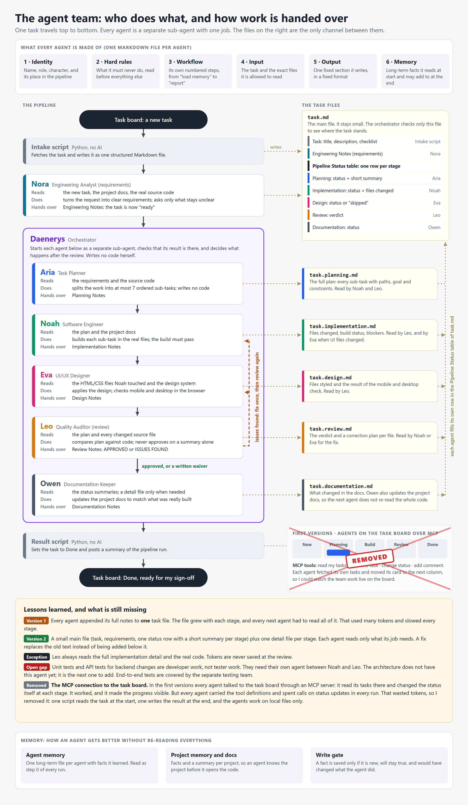
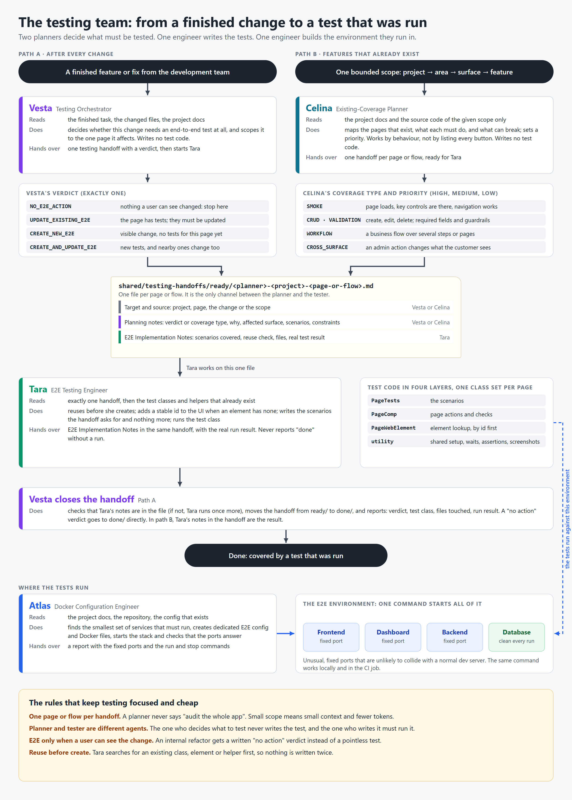

# An AI agent team built on software engineering principles

This is how I build software with AI agents: not one assistant that does everything, but a team where every agent has one job, a fixed input, a fixed output, and rules it cannot break. The structure follows the roles of a real software team, because the reasons for those roles do not disappear when the developer is an AI.

This repository contains the agent definitions themselves. Each Markdown file is the complete instruction set of one agent. The files are written for Claude Code: an orchestrator session starts each agent as a separate sub-agent with its file attached.

Not included: the two small scripts that read from and write to the task board, the project documentation, and the agents' memory files. The agents expect them in `tasks/`, `projects/` and a `memory/` folder per team.

## The software team

Source of the diagram: [diagrams/agents-handoff.html](diagrams/agents-handoff.html)

| Agent | Role | One job |
|---|---|---|
| [Nora](software-team/nora.md) | Engineering Analyst | Turns a raw task into clear requirements by reading the real code first |
| [Daenerys](software-team/daenerys.md) | Orchestrator | Runs every agent as a separate sub-agent, checks each result, decides after the review |
| [Aria](software-team/aria.md) | Task Planner | Splits the work into small ordered sub-tasks; writes no code |
| [Noah](software-team/noah.md) | Software Engineer | Implements the plan in the real files; the build must pass |
| [Eva](software-team/eva.md) | UI/UX Designer | Applies the design system and checks mobile and desktop in the browser |
| [Leo](software-team/leo.md) | Quality Auditor | Reads every changed file and compares plan against code; approves or sends back |
| [Owen](software-team/owen.md) | Documentation Keeper | Keeps the project docs current so the next agent need not re-read the code |

## The testing team

Source of the diagram: [diagrams/testing-team.html](diagrams/testing-team.html)

| Agent | Role | One job |
|---|---|---|
| [Vesta](testing-team/vesta.md) | Testing Orchestrator | Decides whether a finished change needs an end-to-end test, and scopes it to one page |
| [Celina](testing-team/celina.md) | Existing-Coverage Planner | Maps features that already exist and plans their test coverage by behaviour and risk |
| [Tara](testing-team/tara.md) | E2E Testing Engineer | Writes exactly the tests a handoff asks for, reuses what exists, and runs them |
| [Atlas](testing-team/atlas.md) | Docker Configuration Engineer | Builds the disposable environment the tests run in, and proves it starts |

## The principles behind the structure

**Separation of duties.** The agent that writes code does not review it. The agent that decides what to test does not write the test. End-to-end tests belong to a separate testing team, not to the developers.

**A fixed contract per agent.** Every agent file has the same skeleton: identity, hard rules, a numbered workflow, the input it may read, its one fixed output, and its memory. An agent is kept from drifting into another agent's job, because its file also says what it does not do.

**Files are the only channel.** Agents never talk to each other directly. Each one reads what the previous one wrote, then writes its own file and its own status row. The orchestrator checks both before the next agent starts, so a stopped run resumes at the right stage.

**Small context on purpose.** In the first version every agent appended its full notes to one task file. The file grew with each stage and used many tokens. Now a task is a small main file with a `Pipeline Status` table (one row and a short summary per stage) plus one detail file per stage, and each agent reads only what its job needs. A fix replaces the old text instead of being added below it. The reviewer is the exception: he always reads the full code. The agent files still accept the old format, so a task that started in it can finish in it.

**One revision cycle, then a decision.** When the review finds issues, the work goes back once. If issues remain, the orchestrator waives them in writing with a reason and moves on. No endless loops.

**Memory with a gate.** Each agent reads its long-term memory at the start of every run. It may add a fact at the end only if the fact is durable and worth keeping; the development agents apply a strict gate: new, will stay true, and would have changed what the agent did.

**The right model for the job.** The strongest model plans, a coding model implements and reviews (the reviewer always in a fresh context), and a small model documents.

**A human signs off.** No agent deploys. The pipeline ends at "done, ready for sign-off".

## What is still missing

Unit tests and API tests for backend changes are developer work, not tester work. They need their own agent in the development pipeline, between the engineer and the reviewer. The architecture does not have this agent yet; it is the next one to add.

## Author

Amer Ibrahim. Full-stack developer (Angular/TypeScript, Java/Spring Boot, Python) working with LLM workflows and multi-agent systems.
